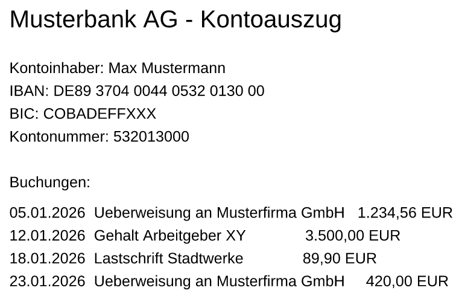
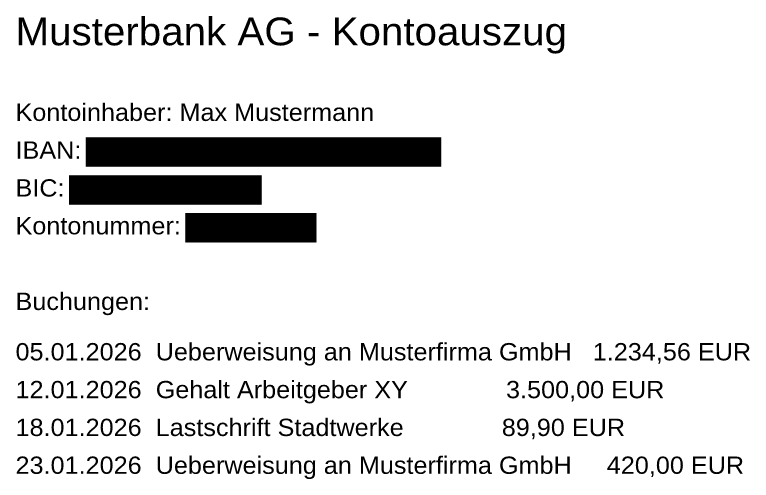

# redact-rs

Ein schlankes, **lokales** CLI- und GUI-Werkzeug in Rust zum Schwärzen sensibler
Daten in PDF-Dokumenten (Bankunterlagen, Kontoauszüge, Rechnungen).

<table>
<tr>
<th width="50%">vorher — <code>kontoauszug.pdf</code></th>
<th width="50%">nachher — <code>kontoauszug_geschwaerzt.pdf</code></th>
</tr>
<tr>
<td></td>
<td></td>
</tr>
</table>


**Der schwarze Balken ist nicht der Punkt.** Ein Rechteck über den Text legen
kann jedes Textverarbeitungsprogramm — und darunter steht die IBAN weiter.
Nach einem Lauf von redact-rs steht sie **nicht mehr in der Datei**, auch nicht
in einem komprimierten Objektstrom, in einer Altrevision oder als UTF-16 — und
das [misst das Programm selbst nach](docs/pruefen.md) (`--check-leaks`,
Rückgabewert 3 bei einem Fund).

**Und „Max Mustermann“ steht rechts noch da.** Absichtlich: für Namen gibt es
kein Muster und keine Named-Entity-Erkennung; sie bleiben stehen, bis sie von
Hand oder über die Buchungsliste erfasst werden
([was dieses Werkzeug nicht leistet](docs/grenzen.md#erkennung)). Woraus jeder
Beleg entstanden ist und was er ausdrücklich **nicht** zeigt:
[`docs/vorher-nachher.md`](docs/vorher-nachher.md).

* **Manuelle Schwärzung** über Regionen (JSON oder per Maus in der GUI)
* **Automatische Schwärzung** über Regex-Muster (IBAN, BIC, Steuer-ID, …)
* **Buchungsliste** mit Positiv- und Negativliste (CSV)
* **Echte Schwärzung**: der gefundene Text wird aus dem Content-Stream
  *entfernt*, nicht nur übermalt
* **Auch in Bildern**: unter einer Schwärzung werden die **Pixel
  überschrieben**, nicht überdeckt ([Details](docs/bilder.md))
* **Nachprüfbar**: `--check-leaks "DE89 …"` sagt, ob ein Text noch irgendwo in
  der fertigen Datei steht ([Details](docs/pruefen.md))
* **Keine Cloud**, keine Netzverbindung, deterministische Ausgabe

> **Vor dem ersten Einsatz bitte zwei Seiten lesen:**
> [Prüfen, ob die Schwärzung gewirkt hat](docs/pruefen.md) und
> [Was dieses Werkzeug nicht leistet](docs/grenzen.md).
> Die verbreitete Kontrolle (`pdftotext … | grep …`) gibt nachweislich falsche
> Entwarnung; die gemeinte Kontrolle steckt im Programm selbst
> (`--check-leaks`).

> **Wer von einer älteren Fassung kommt, liest zuerst
> [`CHANGELOG.md`](CHANGELOG.md).** Einträge, die Lecks älterer Fassungen
> schließen, sind dort mit **⚠ Sicherheit** gekennzeichnet und sagen, ob bereits
> erzeugte Ergebnisse nachzuprüfen sind.

## Installation

Fertige Binaries für Windows und Linux liegen unter
[Releases](https://github.com/thoscut/redactrs/releases):

| Archiv | Inhalt |
|---|---|
| `redact-rs-<version>-x86_64-windows.zip` | `redact-rs.exe` (Konsole) + `redact-rs-gui.exe` (zum Doppelklicken) |
| `redact-rs-<version>-x86_64-linux.tar.gz` | `redact-rs` (glibc, mit Oberfläche) |
| `redact-rs-<version>-x86_64-linux-musl.tar.gz` | `redact-rs` (statisch, **ohne** Oberfläche) — für Linux-Fassungen, auf denen der glibc-Bau nicht läuft |

Die SHA-256-Prüfsummen (`SHA256SUMS`, `SHA256SUMS-BINARIES`) sind eigene
Release-Dateien und gehören getrennt heruntergeladen und geprüft.

Selbst bauen (benötigt **Rust 1.88** oder neuer):

```bash
git clone https://github.com/thoscut/redactrs
cd redactrs
cargo build --release                                    # mit GUI
cargo build --release -p redact-cli --no-default-features # nur CLI
```

Was in den Archiven liegt, welche Systempakete die Oberfläche unter Linux
braucht und welche Binaries ein Bau erzeugt:
[`docs/installation.md`](docs/installation.md).

## Schnellstart

```bash
# Beispiel-Kontoauszug erzeugen
redact-rs --write-demo kontoauszug.pdf

# Automatisch schwärzen — Ergebnis landet als kontoauszug_geschwaerzt.pdf
# direkt neben der Eingabedatei
redact-rs kontoauszug.pdf --patterns iban_de,bic,email
```

Und dann **nicht** aufhören. Der Lauf oben schränkt mit `--patterns` bewusst auf
drei Muster ein und entfernt darum nur IBAN, BIC und E-Mail-Adresse — Kontoinhaber,
Kontonummer, Telefonnummer und Steuer-ID lässt er stehen (nachgemessen:
4 Schwärzungen). Ohne `--patterns` greifen die Vorgabemuster und es werden
7 Schwärzungen; übrig bleibt dann von den schützenswerten Angaben nur der
**Name**, denn dafür gibt es kein Muster:

```console
$ redact-rs kontoauszug.pdf -o std.pdf --force
Treffer gesamt:     7
Schwärzungen:       7
$ pdftotext std.pdf -
Kontoinhaber: Max Mustermann      ← steht noch da
IBAN:
Kontonummer:
Telefon:
Steuer-ID:
```

Wie man das feststellt, steht unter
[Prüfen, ob die Schwärzung gewirkt hat](docs/pruefen.md).

## Dokumentation

| Seite | Inhalt |
|---|---|
| [Installation](docs/installation.md) | Archive, Prüfsummen, selbst bauen |
| [Kommandozeile](docs/kommandozeile.md) | Optionen, Rückgabewerte, verschlüsselte PDFs, Stapelbetrieb, Einstellungsdatei, eingebaute und eigene Muster, Buchungsliste, manuelle Regionen |
| [Bilder](docs/bilder.md) | wie Rasterbilder geschwärzt werden und was das kostet |
| [Review-Workflow und Audit-Log](docs/review-und-audit.md) | erst prüfen, dann anwenden; was das Audit-Log bezeugt |
| [Prüfen, ob die Schwärzung gewirkt hat](docs/pruefen.md) | `--check-leaks`, die Gegenprobe, warum `pdftotext … \| grep …` nicht taugt |
| [Was dieses Werkzeug nicht leistet](docs/grenzen.md) | Erkennung, gescannte Dokumente, Grenzen der Verarbeitung, was der Nutzer selbst tun muss |
| [Grafische Oberfläche](docs/oberflaeche.md) | Bedienung, Tastatur, Nachprüfung nach dem Export |
| [Sicherheit — was zugesichert wird](docs/zusicherungen.md) | entfernte Metadaten, Schreibpfad, Kernabzug |
| [Architektur und Stand der Umsetzung](docs/architektur.md) | Crates, Ablauf, Abweichungen vom Konzept, Akzeptanzkriterien |
| [Entwicklung und Release](docs/entwicklung.md) | Tests, Belege neu erzeugen, Release bauen |

Dieselbe Doku liegt als HTML-Buch mit Suche in jedem Release-Archiv
(`doku/index.html`); selbst bauen mit `./scripts/build-doku.sh` (mdBook,
[Einzelheiten](docs/entwicklung.md#die-doku-als-buch-bauen)).

Daneben: [`SECURITY.md`](SECURITY.md) — Bedrohungsmodell, Grenzen für
Eingabedateien, Messungen. [`CHANGELOG.md`](CHANGELOG.md) — was sich zwischen
zwei Fassungen geändert hat. [`CONTRIBUTING.md`](CONTRIBUTING.md) — Mitarbeit.
[`ROADMAP.md`](ROADMAP.md) — was geplant ist.

## Lizenz

Wahlweise [MIT](LICENSE-MIT) oder [Apache-2.0](LICENSE-APACHE).
